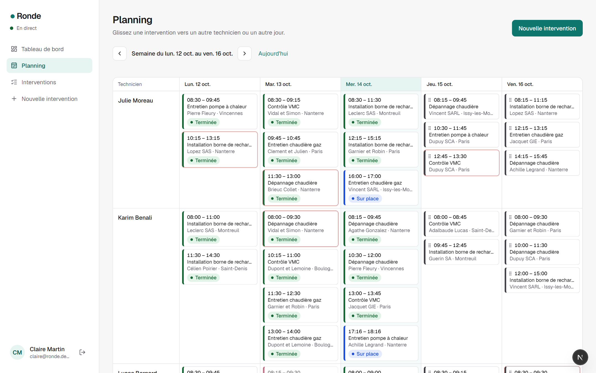
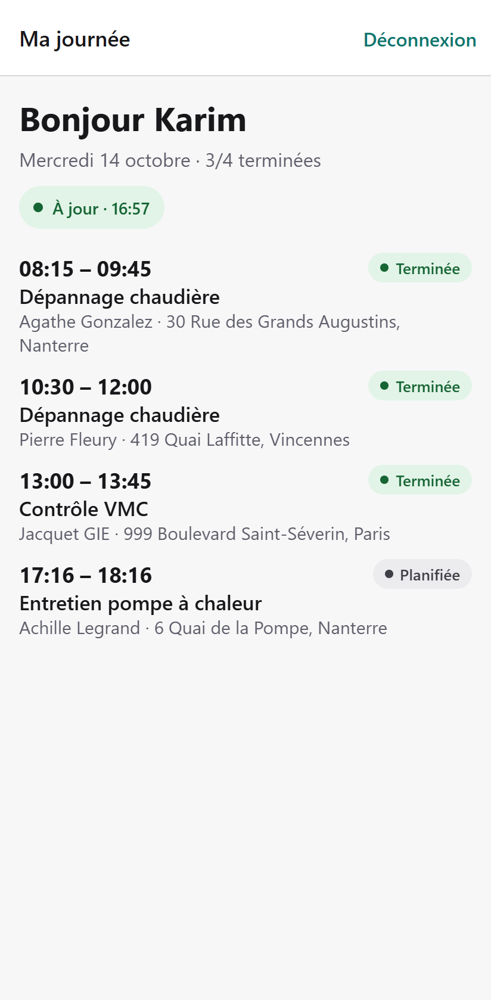
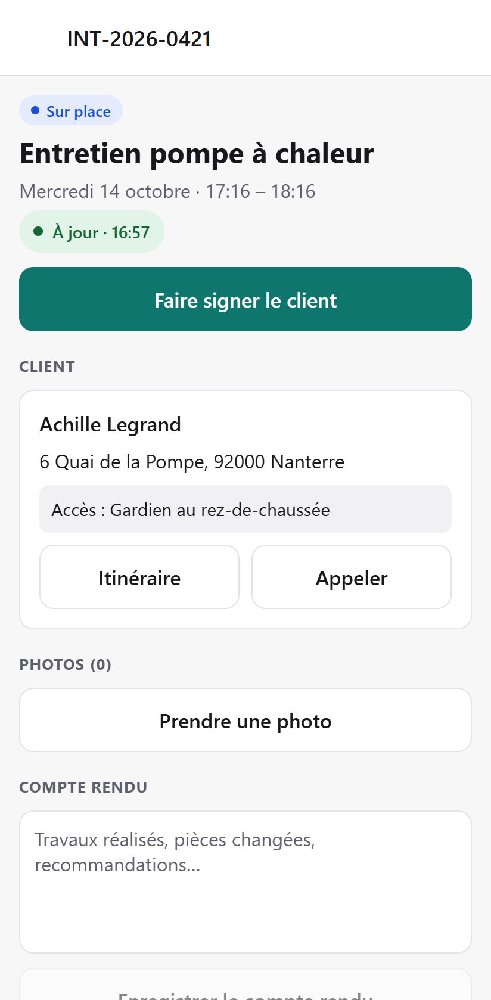
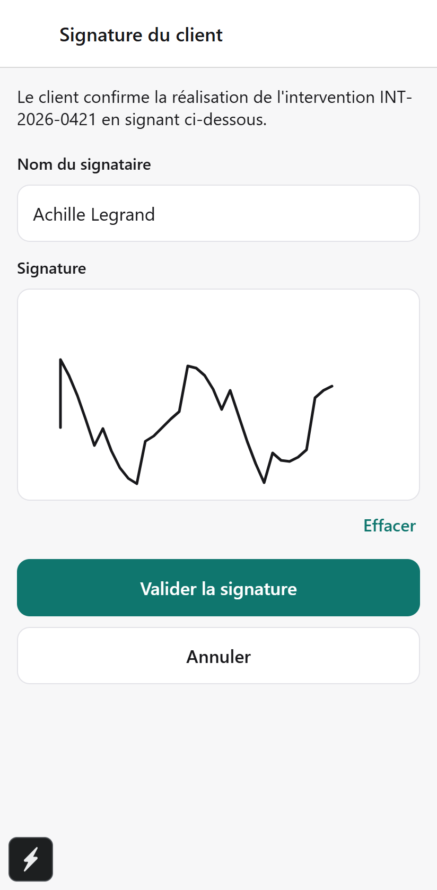

# Ronde

[](https://github.com/mcpolo78/ronde/actions/workflows/ci.yml)

> Planifiez, suivez et clôturez les interventions de vos techniciens — même sans réseau.

**Démo en ligne : <https://ronde-six.vercel.app>** — compte `claire@ronde.demo`, mot de passe `demo-ronde`. Données régénérées chaque nuit ; si l’API était en veille, le premier chargement peut prendre une trentaine de secondes.

Ronde est une plateforme métier pour les PME de maintenance (chauffage, bornes de recharge, VMC…) :

- **Back-office web** (Next.js) pour la responsable planning : planning glisser-déposer, carte, suivi en direct, indicateurs.
- **App mobile** (Expo) pour les techniciens : journée préchargée, statuts, photos, signature client, **fonctionnement hors ligne**.

Pourquoi ce projet, pour qui, et comment on mesure son succès : voir [docs/discovery.md](docs/discovery.md).

<p align="center">
  
</p>
<p align="center">
  
  
  
</p>

### Le back-office

- **Tableau de bord** : activité du jour par technicien, interventions à traiter, indicateurs sur 30 jours (résolution à la 1re visite, durée sur site, retard moyen).
- **Planning** de la semaine : glisser-déposer vers un autre technicien ou un autre jour, mise à jour optimiste, et une **alternative clavier** (bouton « Déplacer ») avec annonces pour lecteurs d'écran.
- **Liste filtrable** (statut, technicien, semaine) — les filtres sont un formulaire GET : ils fonctionnent sans JavaScript et l'URL est partageable.
- **Fiche intervention** : client, accès, checklist, historique horodaté des statuts, preuves de passage ; annulation avec confirmation.
- **Création** avec les mêmes règles de validation que l'API (schémas Zod partagés).
- **Temps réel** : les changements faits sur le terrain apparaissent sans recharger (subscription GraphQL en SSE).

### L'app technicien

- **Ma journée** préchargée et consultable **sans réseau** ; indicateur de synchronisation toujours visible (« À jour », « Hors ligne · 3 actions en attente »).
- **Une action principale à la fois** : « Je pars », « Je suis arrivé », « Faire signer le client », « Clôturer » — les mêmes règles que le serveur (on ne clôture pas sans signature).
- **Itinéraire et appel** en un geste, consignes d'accès, checklist, photos (compressées et conservées sur l'appareil jusqu'à l'envoi), compte rendu.
- **Signature du client** au doigt : le serveur reconstruit le SVG à partir des tracés (aucun balisage client servi).
- **Hors ligne** : tout se met en file et part dans l'ordre au retour du réseau, sans doublon ; une intervention annulée par le bureau pendant la coupure est signalée clairement.

## Architecture

```
ronde/
├─ apps/
│  ├─ api/        Node · GraphQL Yoga · Pothos · Prisma 7 · PostgreSQL
│  ├─ web/        Next.js 16 (App Router, Cache Components) · Tailwind CSS 4 · Better Auth · dnd-kit
│  └─ mobile/     Expo SDK 57 · Expo Router · file de synchro hors ligne (zustand + AsyncStorage)
├─ packages/
│  ├─ domain/     règles métier pures et testées (cycle de vie, indicateurs, validations Zod)
│  ├─ graphql/    schéma SDL exporté par l'API + gql.tada → requêtes typées côté clients
│  └─ config/     configuration TypeScript partagée
└─ docs/          discovery + décisions d'architecture (ADR)
```

Les règles métier (qui peut passer une intervention de quel statut à quel autre, signature obligatoire pour clôturer…) vivent **une seule fois** dans `packages/domain` : l'API les applique côté serveur, l'app mobile les utilise pour ses mises à jour optimistes hors ligne.

### Décisions d'architecture

| # | Décision |
|---|---|
| [0001](docs/adr/0001-monorepo.md) | Monorepo Turborepo + pnpm |
| [0002](docs/adr/0002-graphql-code-first.md) | GraphQL code-first avec Pothos et Prisma |
| [0003](docs/adr/0003-offline-first-mobile.md) | Mobile offline-first : mutations idempotentes |
| [0004](docs/adr/0004-auth-et-acces-api-web.md) | Authentification et accès à l'API depuis le back-office (proxy first-party) |
| [0005](docs/adr/0005-app-mobile.md) | App technicien : synchronisation, signature, fichiers, tests |

## Démarrer en local

Prérequis : Node 24, pnpm. **Pas besoin de Docker** : `pnpm db:dev` lance un vrai PostgreSQL 17 embarqué.

```bash
pnpm install
cp apps/api/.env.example apps/api/.env  # puis renseigner BETTER_AUTH_SECRET
pnpm db:dev                             # PostgreSQL sur :5433 — laisser tourner dans un terminal
pnpm codegen                            # client Prisma + schéma GraphQL + types des clients
pnpm db:deploy && pnpm db:seed          # migrations + données de démo
pnpm dev                                # API :4000 · web :3000 · Expo :8081
```

**App mobile** : installer *Expo Go* sur un téléphone connecté au même Wi-Fi et scanner le QR code affiché par `pnpm dev` (l'app trouve seule l'API de la machine). Elle tourne aussi dans le navigateur : touche `w` dans le terminal Expo.

Back-office : <http://localhost:3000> · GraphiQL : <http://localhost:4000/graphql>.

**Comptes de démo** — mot de passe `demo-ronde` :

| Rôle | Email |
|---|---|
| Responsable planning | `claire@ronde.demo` |
| Technicien (app mobile) | `karim@ronde.demo` |

En développement, l'en-tête `x-dev-user: <email>` permet aussi d'interroger l'API sans session (GraphiQL), si `ALLOW_DEV_IMPERSONATION=true`.

## Déploiement

Neon (base) · Render (API) · Vercel (back-office), tous en région Francfort ; données de démo régénérées chaque nuit par GitHub Actions. Procédure : [docs/deploiement.md](docs/deploiement.md).

## Qualité

```bash
pnpm typecheck   # TypeScript strict partout
pnpm lint
pnpm test        # Vitest : règles métier, dates en heure de Paris, file de synchronisation
pnpm --filter @ronde/web test:e2e      # Playwright : back-office
pnpm --filter @ronde/mobile test:e2e   # Playwright : app technicien, réseau coupé puis rétabli
```

- **Back-office** : connexion, redirections, rôle technicien, création avec validation, annulation, filtres, déplacement au clavier et à la souris dans le planning. Les tests **échouent aussi en cas d'erreur dans la console du navigateur** (hydratation, exceptions).
- **App technicien** (version web, téléphone simulé) : une intervention complète faite **hors ligne** — départ, arrivée, photo, compte rendu, signature, clôture — puis retour du réseau : l'état est vérifié **en base**, et une seconde synchronisation ne crée aucun doublon. Second scénario : le bureau annule l'intervention pendant la coupure, l'app le signale.

La CI GitHub Actions exécute tout cela à chaque push et pull request, E2E compris (Postgres en service, Chromium headless).

## Avancement

- [x] **S1** — Monorepo, CI, modèle de données, API GraphQL (requêtes, mutations, temps réel), données de démo, règles métier testées
- [x] **S2** — Authentification, back-office : tableau de bord, planning glisser-déposer, liste, fiche, création, temps réel, tests E2E
- [x] **S3** — App technicien : journée, statuts, checklist, photos, signature, compte rendu, hors ligne, E2E
- [ ] **S4** — Carte, notifications push, build installable (EAS), audit accessibilité et performance

## Roadmap (hors V1)

Facturation et devis · gestion multi-entreprises · gestion des stocks de pièces · géolocalisation en arrière-plan.
